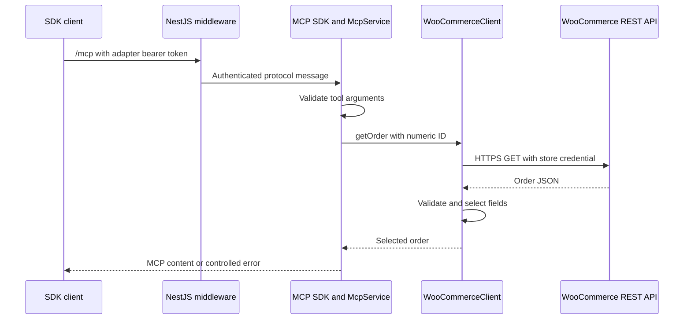

# Part 2 — Build and understand the five MCP tools with NestJS

> Urumi AI FDE internship course · Updated 22 October 2026  
> Level: beginner to intermediate. Follow one request through the code before reading the next tool.  
> Previous: [Part 1](01-foundations-and-store.md) · Next: [Part 3](03-gateway-to-final-submission.md)

## What you will accomplish

You will understand the existing adapter well enough to explain its architecture, trace all five operations, reproduce the checks, and identify its limitations.

**Implemented:** all five tools and NestJS integration exist.  
**Previously verified:** 25 fixture tests, typecheck, build, compiled discovery and live store calls passed on 22 October.  
**Not implemented here:** gateway, member accounts, dashboard, LLM chat and adapter Kubernetes deployment.

This is a guided reading and reconstruction sequence. The code excerpts explain the actual source; they are not instructions to overwrite entire files. Open the referenced source beside this document.

## Contents

- [1. MCP vocabulary through this assignment](#1-mcp-vocabulary-through-this-assignment)
- [2. Plan the adapter boundary](#2-plan-the-adapter-boundary)
- [3. Map the codebase](#3-map-the-codebase)
- [4. Understand NestJS startup and injection](#4-understand-nestjs-startup-and-injection)
- [5. Define strict tool contracts](#5-define-strict-tool-contracts)
- [6. Build the shared store client](#6-build-the-shared-store-client)
- [7. Register tools and protect the endpoint](#7-register-tools-and-protect-the-endpoint)
- [8. Implement list products](#8-implement-list-products)
- [9. Implement create product](#9-implement-create-product)
- [10. Implement list orders](#10-implement-list-orders)
- [11. Implement get order](#11-implement-get-order)
- [12. Implement update order status](#12-implement-update-order-status)
- [13. Understand the tests](#13-understand-the-tests)
- [14. Verify the real store](#14-verify-the-real-store)
- [15. Diagnose errors](#15-diagnose-errors)
- [16. Prepare for the gateway](#16-prepare-for-the-gateway)

## 1. MCP vocabulary through this assignment

### Host and client

The host is the application using tools. It creates an MCP client to communicate with an MCP server.

Our smoke script creates a client directly. Later, an external desktop application will connect to the gateway. The gateway will itself create clients for upstream servers.

### Server and tool

Our WooCommerce adapter is a server. A tool is one named capability it exposes: description, schema and handler.

**Discovery** retrieves the available definitions. **Invocation** calls one named tool with arguments.

The official SDK handles protocol details. We write the actual store behavior and access boundary. See the [MCP architecture documentation](https://modelcontextprotocol.io/docs/2026-07-28/learn/architecture) and [official TypeScript SDK](https://github.com/modelcontextprotocol/typescript-sdk).

### Streamable HTTP

The SDK exchanges MCP messages through the HTTP endpoint `/mcp`. It can handle ordinary JSON responses and streaming protocol behavior. We let its transport implementation manage those details.

Do not assume that every MCP response must be an event stream or that every client uses an identical initialization flow. Our fixtures exercise the pinned SDK's modern and legacy paths.

### REST versus MCP in our implementation

```text
MCP client
  -> get_order({order_id: 14})
  -> our adapter
  -> GET /wp-json/wc/v3/orders/14
  -> WooCommerce
```

MCP makes the operation discoverable to an MCP client. REST is the existing interface we use to reach WooCommerce. We do not replace WordPress with a model or expose raw SQL.

**Exercise 1:** explain why we can test MCP without choosing an LLM provider.

## 2. Plan the adapter boundary

Before coding a component, answer three questions.

### What are we building?

A small translation layer exposing exactly the required store operations through MCP. It runs independently of the gateway.

### Why is it needed?

WooCommerce already exposes REST, but our gateway needs an upstream MCP server. The adapter presents discoverable tool schemas, handles store authentication and limits the returned fields.

### How does the data move?



The current local caller reaches a loopback host process. The final caller must reach this adapter through the gateway inside Kubernetes.

### Explicit non-goals for this component

The adapter does not own team accounts, member key hashing, invitations or gateway audits. It does not implement payment refunds, arbitrary SQL, arbitrary REST requests or multi-store provisioning.

It has one configured store. Caller-controlled URLs are rejected rather than accepted as tool arguments.

## 3. Map the codebase

### Application source

```text
src/
  main.ts
  server.ts
  woocommerce.module.ts
  health.controller.ts
  woocommerce.ts
  mcp/
    mcp.service.ts
  tools/
    schemas.ts
```

There are seven application source files:

1. `main.ts` — environment configuration, construction and listening.
2. `server.ts` — Nest application factory and middleware installation.
3. `woocommerce.module.ts` — dependency registration.
4. `health.controller.ts` — process health route.
5. `woocommerce.ts` — five public store methods and shared private request logic.
6. `mcp/mcp.service.ts` — MCP definitions, handlers, authentication and lifecycle.
7. `tools/schemas.ts` — input contracts and output selection.

The number of functions is not a requirement or useful measure of completion. The important boundaries are protocol, contracts, store requests and application lifecycle.

### Supporting files

- `package.json` and `package-lock.json` pin dependencies and scripts.
- `tsconfig.json` includes strict checking and decorator support.
- `tsconfig.build.json` compiles application code into `dist`.
- `test/woocommerce.test.ts` contains the original protocol and failure regression tests.
- `test/five-tools.test.ts` checks the expanded operations and safety boundaries.
- `scripts/smoke-live-store.ts` uses a real SDK client against the real store.
- `scripts/run-local-adapter.ps1` prepares local CA trust and runs the application or smoke check.

**Checkpoint:** open these files in the order listed. Before reading a method, predict which file should own it.

## 4. Understand NestJS startup and injection

### Lesson 4A — The process entry point

Open `src/main.ts`.

The program reads required environment values, validates the port and constructs `WooCommerceClient`. Missing configuration fails early rather than causing an obscure error during a tool call.

It then awaits `createWooCommerceServer` and listens on `127.0.0.1`. SIGINT and SIGTERM trigger cleanup.

Loopback binding is intentional for this development checkpoint. A Kubernetes pod will need a configurable `0.0.0.0` binding later. Copying the current binding into a container unchanged would make the Service unable to reach it.

### Lesson 4B — The Nest application factory

From `src/server.ts`:

```typescript
const app = await NestFactory.create(
  WooCommerceModule.register(store, token),
  {
    bodyParser: false,
    logger: false,
    abortOnError: false,
  },
);

app.use(app.get(McpService).middleware);
await app.init();
```

Read the important decisions:

- `register(store, token)` supplies already validated configuration.
- `bodyParser: false` preserves the raw request stream for the MCP SDK.
- `app.get(McpService)` retrieves the injected provider instance.
- `app.use` installs the protocol middleware before normal route handling.
- `app.init` prepares the application; the caller chooses a listening port.
- Nest logging is currently disabled. That is not completed observability; the final gateway needs safe structured logs.

The factory returns the Nest app, its underlying HTTP server and a cleanup function. Tests use an available port rather than fighting over 3001.

### Lesson 4C — The module

From `src/woocommerce.module.ts`:

```typescript
providers: [
  { provide: WooCommerceClient, useValue: store },
  {
    provide: McpService,
    inject: [WooCommerceClient],
    useFactory: (client: WooCommerceClient) =>
      new McpService(client, token),
  },
]
```

`useValue` registers a constructed store client. `inject` identifies its dependency. `useFactory` constructs the MCP service.

The explicit factory also works under tsx, which does not emit TypeScript decorator metadata the same way as the compiler. We do not rely on implicit constructor inference for this dependency.

A module is an organizational and dependency boundary, not automatically a separately deployed microservice. See [NestJS modules](https://docs.nestjs.com/modules) and [custom providers](https://docs.nestjs.com/fundamentals/custom-providers).

### Lesson 4D — The controller

`HealthController` returns `{"status":"ok"}` from `GET /healthz`.

This checks process responsiveness. It does not prove database access, store readiness or successful checkout. The existing adapter has no separate readiness endpoint yet.

### Mini exercise

Explain what would happen if an Express JSON parser consumed the request before the SDK read it. Then explain why this concern is different from whether tool arguments are validated.

## 5. Define strict tool contracts

Open `src/tools/schemas.ts`.

### Validate runtime data

TypeScript types disappear at runtime. Network callers can send strings, fractions or extra fields regardless of the TypeScript annotation in our source.

Zod validates the actual runtime value.

```typescript
const id = z.number()
  .int()
  .positive()
  .max(Number.MAX_SAFE_INTEGER);

export const getOrderInput = z.strictObject({
  order_id: id,
});
```

Allowed:

```json
{"order_id":14}
```

Rejected:

```json
{"order_id":"14"}
```

Also rejected: zero, negatives, fractions, unsafe integers, and unknown fields such as `url`.

### Separate input from output

Input contracts describe what a caller may request. Output contracts describe what we return from WooCommerce.

```typescript
export const productSchema = z.object({
  id,
  name: z.string(),
  price: z.string(),
  status: z.string(),
  permalink: z.string(),
});
```

The output object strips other fields. The order output similarly selects business fields and selected line-item fields.

This selection omits billing/shipping addresses, customer email, IP addresses, payment details, order keys and arbitrary metadata. It reduces exposure; it does not implement member-level order access.

### Defaults versus coercion

Pagination defaults to page 1 and 10 items. That does not mean `"2"` is silently accepted as numeric page 2. The contracts intentionally use numeric values.

**Exercise 2:** try predicting the result of page 0, page 1.5, per_page 101 and an extra `url` field before reading the tests.

## 6. Build the shared store client

Open `src/woocommerce.ts`.

### Step 6A — Validate configuration once

The constructor:

1. Parses the store base URL.
2. Requires HTTPS unless HTTP was explicitly enabled for local fixtures.
3. Rejects credentials embedded in the URL, query strings and fragments.
4. Validates credential presence and timeout bounds.
5. Constructs one fixed WooCommerce REST base.
6. Builds the Basic authentication header privately.

Basic authentication is an encoding of a credential, not encryption. HTTPS protects its transport. Our requests use headers rather than credential query parameters.

### Step 6B — Keep operation methods small

Each method parses its contract, chooses a fixed path/method and delegates to `request`. Five methods should not contain five subtly different versions of timeout and error logic.

### Step 6C — Bound the request

The shared helper:

- Uses a five-second default timeout.
- Keeps that deadline active while reading the body.
- Rejects redirects.
- Limits the response body to 2 MB.
- Checks HTTP status.
- Parses JSON.
- Validates and selects output fields.
- Reads real pagination totals when available.
- Returns only controlled error messages.

This protects against a server that sends headers promptly but then stalls or sends an unexpectedly large body.

### Step 6D — Treat write failure carefully

Suppose product creation reaches WooCommerce, commits successfully and then the network connection fails. The caller sees failure even though the product exists.

The adapter does not automatically retry. For ambiguous write failures it warns:

```text
Write outcome may be unknown; inspect the store before retrying.
```

That is an operational limitation, not an exactly-once guarantee. A SKU can help inspection but does not make every operation automatically safe to retry.

### Step 6E — Do not reveal raw upstream failures

WooCommerce can return HTML, plugin messages or internal detail. We do not pass those arbitrary bodies or nested fetch errors to an MCP caller.

HTTP 401/403 produces a controlled credential-permission message. HTTP 404 produces a resource-not-found message. Other HTTP statuses remain visible as safe status numbers.

### Checkpoint

Explain which deadline protects:

1. Waiting for response headers.
2. Waiting for the remaining body.
3. Waiting for the future gateway's other upstream servers.

The first two are this helper's responsibility. The third belongs to gateway design in Part 3.

## 7. Register tools and protect the endpoint

Open `src/mcp/mcp.service.ts`.

### Step 7A — Create an SDK server

```typescript
const server = new McpServer({
  name: 'urumi-woocommerce',
  version: '0.2.0',
});
```

This is our MCP server's identity. It is not the NestJS version.

### Step 7B — Register one tool

```typescript
server.registerTool('get_order', {
  description: 'Get one order by its positive numeric ID.',
  inputSchema: getOrderInput,
  annotations: read,
}, safe(input => store.getOrder(input)));
```

This excerpt shortens the actual description. Read the source for the full text.

- The name is what callers discover.
- The schema describes and validates arguments.
- The handler calls our store method.
- The wrapper turns selected results into MCP text content.
- The SDK handles protocol-level behavior.

### Step 7C — Convert a result

The shared wrapper returns a text item containing JSON on success. Controlled store failures return `isError: true`.

The current implementation does not advertise a structured output schema. Consumers parse the text JSON shown in tests. Structured output could be added later, but it is not necessary to claim this milestone works.

### Step 7D — Authenticate every MCP request

The middleware first validates Host and Origin. It passes other paths to Nest route handling. For `/mcp`, it compares the supplied bearer token to the configured token using a length check and `timingSafeEqual`.

Missing or wrong tokens receive HTTP 401. Host/Origin validation reduces localhost browser attack exposure. These checks are not a substitute for the final member authorization system.

### Step 7E — Understand annotations

Read tools carry a read-only hint. Write tools are marked as changing state and not assumed idempotent.

Hints are metadata. They do not enforce confirmation or prevent a member with a valid adapter token from calling a write tool. The final agent/gateway must implement any required approval or permission behavior.

### Step 7F — Release resources

`McpService` implements `OnModuleDestroy` and closes its SDK handler. Nest cleanup also closes the HTTP server.

**Exercise 3:** explain why authenticating only at initial connection would be insufficient for the final requirement that a revoked key's next call fails.

## 8. Implement list products

### Goal

Read a page of catalog entries without changing the store.

### Contract

```json
{"page":1,"per_page":10}
```

Both fields are optional. Limits are page 1–1000000 and page size 1–100.

### Method

From the current client:

```typescript
async listProducts(input: z.input<typeof listProductsInput> = {}) {
  const { page, per_page } = listProductsInput.parse(input);

  const result = await this.request(
    'products',
    z.array(productSchema),
    { query: { page, per_page } },
  );

  return { products: result.data, page, per_page };
}
```

The REST route is `GET /wp-json/wc/v3/products`.

### Expected result

An object with a products array and pagination inputs. Prices remain strings. The current tool does not return total headers for products; callers can request additional pages explicitly.

### Verify

The fixtures assert the exact REST path, Basic header placement, stripped extras and default pagination. Discovery itself must not make a store request.

### Challenge

Explain why returning every product automatically could make one tool call slow or unbounded. Do not add automatic pagination until its budget and intended use are clear.

## 9. Implement create product

### Goal

Create a simple product with a name and regular price.

### Contract

```json
{
  "name": "Course notebook",
  "regular_price": "79.00",
  "sku": "COURSE-NOTEBOOK-1",
  "description": "A synthetic course product",
  "status": "draft"
}
```

Required: `name` and `regular_price`.

Optional:

- Description up to 2000 characters.
- SKU containing 1–64 letters, digits, hyphens or underscores.
- Status `draft` or `publish`; default `publish`.

Name is trimmed and limited to 200 characters. Price is a nonnegative decimal string with at most two fractional digits and nine integer digits. This deliberately small INR-demo contract does not cover every currency's decimal precision.

### Method

```typescript
async createProduct(input: z.input<typeof createProductInput>) {
  const body = createProductInput.parse(input);

  return {
    product: (
      await this.request('products', productSchema, {
        method: 'POST',
        body: { ...body, type: 'simple' },
      })
    ).data,
  };
}
```

The adapter fixes product type rather than allowing arbitrary product structures. `regular_price` is the write field; `price` is a selected result field.

See the [WooCommerce products API](https://developer.woocommerce.com/docs/apis/rest-api/v3/products/) for the underlying interface.

### Verify

The fixture checks POST, JSON body, trimming, default publish status and fixed simple type. Invalid prices or extra fields must cause no store request.

The live write smoke creates one clearly labelled published product, then finds its ID through `list_products`.

### Challenge

A write times out. What do you inspect before trying again? Explain how blind retries could create multiple products.

## 10. Implement list orders

### Goal

Read a page of orders, optionally filtered by status and creation time.

### Contract

```json
{
  "page": 1,
  "per_page": 20,
  "status": "processing",
  "after": "2026-10-21T00:00:00+05:30",
  "before": "2026-10-22T00:00:00+05:30"
}
```

Accepted read statuses: pending, processing, on-hold, completed, cancelled, refunded and failed. A missing status means no explicit status filter.

Dates require seconds and an explicit offset or `Z`. If both are supplied, after must be earlier than before.

### Understand the implementation

1. Parse input.
2. Add pagination.
3. Add optional status.
4. Convert offset-qualified instants into UTC.
5. Send GMT wall-clock strings plus `dates_are_gmt=true`.
6. Validate the returned order array.
7. Return real pagination totals from headers.

For the example above, UTC boundaries become:

```text
after  = 2026-10-20T18:30:00
before = 2026-10-21T18:30:00
dates_are_gmt = true
```

The missing suffix in the upstream strings is deliberate. Callers still provide explicit offsets.

### The real bug this check caught

Our installed WordPress/WooCommerce query path converted timestamps ending in `Z` into site-local time even when filtering a GMT column. In the current non-UTC store, a narrow range missed an order whose returned GMT timestamp was inside it.

Normalizing the instant to UTC, stripping the suffix only for the upstream GMT wall-clock query, and setting the flag passed both inclusion and exclusion checks. This is verified behavior for this installation, not a statement that every server's date parser behaves identically.

### Understand the output

```json
{
  "orders": [],
  "page": 1,
  "per_page": 20,
  "total": 0,
  "total_pages": 0
}
```

This is an illustrative empty result, not a recorded response. Missing or invalid pagination headers yield `null` totals. Do not calculate an invented overall count from the length of one page.

The underlying [orders API documentation](https://developer.woocommerce.com/docs/apis/rest-api/v3/orders/) describes the filters.

### Verify

Fixtures inspect the exact normalized query. Live checks find order 14 in a range around its GMT creation time and exclude it from a following-day range.

### Challenge

For the final “orders today” question, identify the business timezone, compute the current day's boundaries, and paginate if more than one page exists. Do not hardcode the course's sample date or assume all orders fit in the first page.

## 11. Implement get order

### Goal

Read one order by a positive safe integer ID.

```json
{"order_id":14}
```

The method validates input, calls the fixed `orders/14` path and wraps selected output as `{"order": ...}`.

### What is returned?

- ID and display number.
- Status.
- Currency and total.
- Local and GMT creation date strings.
- Selected line items: ID, product ID, name, quantity and total.

WooCommerce's date strings may omit an offset. Interpret the field named `date_created_gmt` as GMT rather than treating `date_created` as UTC by accident.

### What is not returned?

Addresses, emails, order keys, raw metadata and other omitted fields.

### Verify

Fixtures include private extra fields in the synthetic upstream response and assert they do not appear in the MCP result, including line-item metadata.

**Exercise 4:** find where this filtering happens. Is it in the model's prompt, the React UI or the server-side schema?

## 12. Implement update order status

### Goal

Change a specific order's status while exposing only the intended write field.

```json
{"order_id":16,"status":"processing"}
```

The method sends:

```http
PUT /wp-json/wc/v3/orders/16
Content-Type: application/json

{"status":"processing"}
```

Writable values are pending, processing, on-hold, completed, cancelled and failed.

### Why exclude refunded and trash?

This tool does not implement financial refunds or deletion. Setting a status is not proof that funds were returned. The restriction is our implementation choice; the brief requires a status-update capability, not an unrestricted pass-through to every store operation.

### Side effects

WooCommerce may run hooks, stock updates or emails. We delegate store behavior to WooCommerce rather than writing an independent transition engine.

A valid adapter token currently permits this call. Read/write hints do not enforce confirmation. The future chat interface should display a proposed write and require deliberate user action before execution.

### Verify

Fixtures check PUT and a body containing only `status`. All allowed values are checked. Invalid statuses and arbitrary extra fields must not reach the store.

The live smoke uses a separate synthetic order and confirms the new status by reading it again. It does not change original order 14.

## 13. Understand the tests

### Three different kinds of evidence

**Static checking** catches TypeScript inconsistencies. It does not call the store.

**Fixture integration tests** start a local fake REST upstream and real Nest/MCP server, then connect an actual SDK client. The store data is synthetic, but the HTTP/protocol integration is real.

**Live smoke checks** call actual WooCommerce. They catch integration differences that fixtures cannot predict, such as the date behavior above.

### Run the existing checks

From the project root:

```powershell
npm.cmd run typecheck
npm.cmd test
npm.cmd run build
```

Expected: typecheck and build exit successfully, with **25 tests passed and 0 failed**.

These checks previously passed on 22 October 2026. This documentation task does not rerun or invent new results.

### Read a protocol test

The SDK client setup follows this structure:

```typescript
const client = new Client(
  { name: 'course-client', version: '1.0.0' },
  { versionNegotiation: { mode: 'auto' } },
);

await client.connect(
  new StreamableHTTPClientTransport(endpoint, {
    requestInit: {
      headers: { Authorization: 'Bearer ' + token },
    },
  }),
);

const definitions = await client.listTools();
const result = await client.callTool({
  name: 'get_order',
  arguments: { order_id: 14 },
});
```

This is an excerpt: imports, endpoint construction and cleanup are in the actual tests. The token in fixture tests is synthetic.

### Inspect these failure cases

- Missing or incorrect adapter bearer token.
- Host or Origin outside the localhost policy.
- Invalid pagination or unknown fields.
- Invalid IDs, prices, statuses and date ranges.
- HTTP 400, 401, 403, 404, 429 and 500.
- Redirect response.
- Malformed JSON or invalid response shape.
- Response larger than 2 MB.
- Body that stalls after headers.
- Missing pagination headers.
- Credential and private-field suppression.
- No automatic retry after a write failure.

### Add tests when behavior changes

If changing a schema, test both allowed and rejected examples. If changing timeout logic, test a server that stalls after headers. If changing routing later, test that a disabled route is rejected even with a cached tool definition.

Do not add tests merely to duplicate a line of implementation. Test the externally meaningful boundary.

## 14. Verify the real store

### Step 14A — Check prerequisites

Docker engine running, cluster resumed, store Ready, valid `.env`, and local TLS configured.

Do not print `.env` to troubleshoot. Inspect variable presence privately.

### Step 14B — Run read-only smoke

```powershell
.\scripts\run-local-adapter.ps1 -Smoke
```

It:

1. Starts a temporary Nest adapter on an available loopback port.
2. Checks rejection without an adapter token.
3. Connects an SDK client with the token.
4. Discovers exactly five tools.
5. Lists the original product.
6. Reads original order 14.
7. Checks a containing and excluding date range.
8. Writes sanitized evidence and closes resources.

This command does not exercise writes.

### Step 14C — Run the explicit write demonstration

This command changes the store:

```powershell
.\scripts\run-local-adapter.ps1 -Smoke -WriteChecks
```

The script creates a labelled INR 49 product through MCP. It arranges a separate synthetic order through REST only for testing. Then MCP changes its status from on-hold to processing, and a second read confirms persistence.

`create_order` is not a sixth exposed MCP tool.

Every run creates extra demonstration records. If a write is ambiguous, inspect the store before rerunning. The smoke test is intended for the small demo store and searches at most the first 100 records where it lists them; it is not a full inventory crawler.

### Previously observed live result

On 22 October:

- Existing product 12 was found at 199.
- Original order 14 remained processing, total 199.00.
- New product 15 was created at 49.00.
- Separate new order 16 changed from on-hold to processing.
- Date range inclusion and exclusion checks passed.
- All five tools were discovered and invoked through the actual adapter.

The script writes `.local/five-tools-verification.json`. Later smoke runs replace that file, so a current read-only result will not necessarily contain the earlier write IDs.

### Step 14D — Keep the adapter running

```powershell
.\scripts\run-local-adapter.ps1
```

In another terminal:

```powershell
Invoke-RestMethod http://127.0.0.1:3001/healthz
```

Expected: status `ok`. Stop with Ctrl+C.

No LLM API is used by these commands. The wrapper was also previously verified in Windows PowerShell 5.1.

## 15. Diagnose errors

### HTTP 401 before a tool result

Check the adapter token and bearer header. Do not regenerate the WooCommerce key merely because the adapter rejected a caller.

### Tool error saying access was denied

The adapter authenticated the caller but WooCommerce rejected the server-side store credential. Check integration user, key permissions and revocation.

### Certificate validation failure

Use the wrapper to load CA trust before Node starts. Verify the configured HTTPS endpoint and certificate dates. Do not use `NODE_TLS_REJECT_UNAUTHORIZED=0`.

### Order not found

Confirm the ID in this store. IDs from another deployment are not portable. Check WooCommerce activation and permalinks if the whole REST route is missing.

### Timeout

Wait for WordPress/MySQL readiness after a cold start. Retry a read after the system warms up. For writes, inspect persistent state first.

### Incorrect day

Inspect explicit date offsets, the business timezone and `date_created_gmt`. Do not “fix” a discrepancy by widening every query until it happens to include the desired order.

### Tool is visible but call fails

Discovery describes capability; it does not prove live store availability or permission for every operation. Our tests intentionally prove discovery can work even when the store later fails.

### Secret appears in a log

Stop sharing that output. Determine which logger emitted it, remove that field from future logging and assess whether rotation is needed. Our store chart now omits the Basic-auth username from Apache access logs because it was the consumer key. The change does not erase old logs.

## 16. Prepare for the gateway

### Completed adapter checklist

- [ ] Explain startup, module, provider and middleware responsibilities.
- [ ] Trace a request without skipping input validation.
- [ ] Name all five tools and their write/read behavior.
- [ ] Distinguish adapter token from store credentials.
- [ ] Explain decimal-string prices and explicit date offsets.
- [ ] Explain ambiguous writes and why retries are disabled.
- [ ] Reproduce fixture tests and a read-only real-store check.
- [ ] Identify the host-only deployment and access-control limitations.

### Important remaining boundaries

The current adapter token is shared by trusted callers and permits all tools. The final gateway must identify the individual member, enforce roles, handle revocation and create audit records.

The current adapter binds to loopback and allows localhost Host values. For Kubernetes, we must add explicit internal host configuration rather than disabling validation.

The final adapter cannot have a public Ingress. An internal Service alone is insufficient to enforce “only the gateway”; policy enforcement and a negative access test are required.

### Explain it back

1. What belongs to NestJS and what belongs to the MCP SDK?
2. Why validate again inside the store method if the SDK validates tool arguments?
3. Where are response fields removed?
4. Why can a write fail from the client's perspective but still exist in the store?
5. How will the gateway use this server without learning WooCommerce's internal REST implementation?

### A short interview explanation to practice

“I wrote a WooCommerce MCP adapter hosted by NestJS. The SDK handles MCP transport and discovery. Strict Zod contracts define five store operations, while a shared REST client handles fixed paths, HTTPS authentication, deadlines and controlled errors. The adapter selects the fields it returns. I verified it using synthetic failure fixtures and real WooCommerce calls. It currently runs on the host; gateway identity and cluster-only access are separate remaining milestones.”

Adapt that explanation to your own words. Do not memorize sentences you cannot connect to a source file.

**Continue:** [Part 3 — Gateway through final submission](03-gateway-to-final-submission.md).

## Practice lab before changing code

Predict whether each call reaches WooCommerce. Then locate the fixture assertion
that verifies the same boundary. You do not need a paid model or a running store.

1. get_order with a numeric order_id of 14.
2. get_order with the string "14".
3. create_product with regular_price set to the number 79.
4. list_orders with after later than before.
5. update_order_status with status refunded.

<details>
<summary>Reveal the expected decisions</summary>

1. It reaches the fixed order route if adapter authentication succeeds; actual success still depends on the store.
2. Rejected by the numeric schema before a store request.
3. Rejected because the price contract requires a decimal string.
4. Rejected by the range refinement before a store request.
5. Rejected by this adapter's restricted write-status contract. Reading refunded orders is a different operation.

Run npm.cmd test to reproduce the existing fixture checks. A fixture success proves
the boundary under synthetic conditions, not that a live store is available.

</details>

