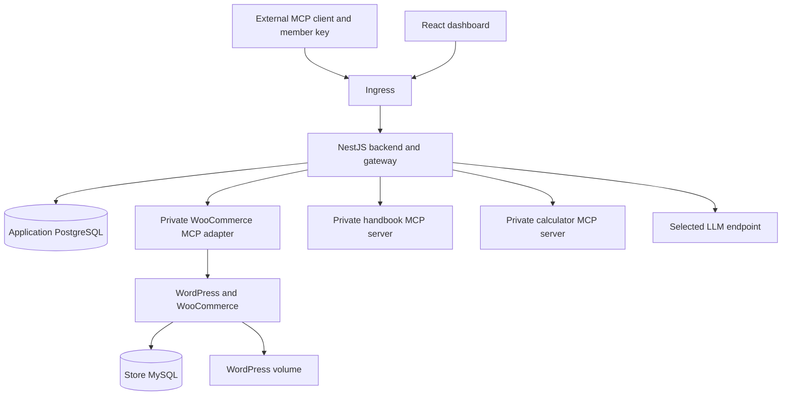

# Part 3 — Build the gateway and finish the assignment

> Urumi AI FDE internship course · Updated 22 October 2026  
> Level: intermediate, introduced one component at a time.  
> Previous: [Part 2](02-nestjs-and-five-mcp-tools.md) · Start: [Part 1](01-foundations-and-store.md)

## Read this before using the build instructions

**The features in this part are build-next work unless explicitly marked existing.** The five-tool adapter and store are the implemented foundation. No database schema, management endpoint, dashboard page, gateway or agent described below should be treated as already working.

Code marked **design sketch** explains an algorithm or contract. It is not a complete tested implementation. Commands marked **after implementation** depend on future files. We will choose exact library versions and verify each component when we build it.

The goal is a complete path through the mandatory requirements, not a large list of bonus features. The architecture below is a recommendation grounded in the brief. The brief does not prescribe NestJS module names, PostgreSQL, a particular ORM or these REST paths.

## Contents

- [1. Understand the final architecture](#1-understand-the-final-architecture)
- [2. Arrange the remaining code without losing the adapter](#2-arrange-the-remaining-code-without-losing-the-adapter)
- [3. Add application persistence](#3-add-application-persistence)
- [4. Build accounts roles and invitations](#4-build-accounts-roles-and-invitations)
- [5. Add personal revocable keys](#5-add-personal-revocable-keys)
- [6. Build upstream management](#6-build-upstream-management)
- [7. Connect to one upstream](#7-connect-to-one-upstream)
- [8. Aggregate discoverable tools and route calls](#8-aggregate-discoverable-tools-and-route-calls)
- [9. Add two more upstream servers](#9-add-two-more-upstream-servers)
- [10. Isolate failures and record every invocation](#10-isolate-failures-and-record-every-invocation)
- [11. Build the React dashboard](#11-build-the-react-dashboard)
- [12. Build the real chat tool loop](#12-build-the-real-chat-tool-loop)
- [13. Deploy the application components with Helm](#13-deploy-the-application-components-with-helm)
- [14. Enforce gateway-only access](#14-enforce-gateway-only-access)
- [15. Connect an external MCP client](#15-connect-an-external-mcp-client)
- [16. Run the complete two-user demonstration](#16-run-the-complete-two-user-demonstration)
- [17. Document production and recovery](#17-document-production-and-recovery)
- [18. Prepare the video and repository](#18-prepare-the-video-and-repository)
- [19. Work backward from the deadline](#19-work-backward-from-the-deadline)
- [20. Final requirements checklist](#20-final-requirements-checklist)

## 1. Understand the final architecture

### The central idea

The gateway has two jobs:

1. It is the MCP server that members connect to.
2. It is the MCP client that connects to upstream servers.

The browser and external clients do not receive upstream credentials. The chat agent uses the same gateway access boundary rather than calling WooCommerce directly.

### Recommended deployment shape

Use one NestJS backend process for dashboard APIs, gateway behavior and the initial agent orchestration. Keep the WooCommerce adapter a separate process. Serve the React build through its own container or a deliberate static-serving layer.

This reduces deployment complexity while preserving the important credential and network boundary. Nest modules do not each need a separate pod.



The handbook and calculator are proposed choices, not installed servers. Another pair is acceptable if they speak Streamable HTTP and support a meaningful two-upstream demonstration.

### Database and service needs

Existing:

- MySQL for the store.
- WordPress content storage.

Recommended next:

- One PostgreSQL application database for users, keys, upstream registrations, invitations and audits.
- No separate database for every Nest module.
- No Redis, message broker or vector database initially.
- A small readonly handbook can use a packaged file; the calculator needs no database.
- Persistent chat history is optional unless needed by our selected implementation.

The brief requires behavior, not a specific number of databases. PostgreSQL is a recommendation based on your existing experience and the relational access/audit model.

### Plan the module boundaries

Suggested Nest modules:

- Auth: login sessions and current identity.
- Team: membership, roles and invitations.
- ApiKeys: creation, verification and revocation.
- Upstreams: registration, safe credentials and connection state.
- Catalog: tool definitions and routing maps.
- Gateway: MCP endpoint and invocation orchestration.
- Audit: durable invocation records and queries.
- Chat: model interaction and tool loop.
- Health: liveness/readiness.

This is a responsibility map. Combine small modules if doing so keeps dependencies clearer. Avoid circular calls between Chat, Gateway and Upstreams.

**Exercise 1:** trace both the browser chat and external client to the same gateway boundary. Identify where each user is authenticated.

## 2. Arrange the remaining code without losing the adapter

### What to do first

1. Preserve a passing adapter baseline.
2. Add the gateway as a separate entry point.
3. Introduce shared types only when two components actually need them.
4. Add the frontend separately.
5. Refactor into a workspace only when its benefits justify the path changes.

A possible future layout:

```text
apps/
  gateway/             Nest backend, management API and chat
  dashboard/           React frontend
  woocommerce-mcp/     existing adapter after a deliberate move
  handbook-mcp/        proposed second upstream
  calculator-mcp/      proposed third upstream
packages/
  contracts/           shared safe DTOs when needed
charts/
  store/               existing chart
  platform/            future application chart
test/
  integration/
  e2e/
docs/
  course/              these three documents
```

**Proposed layout only. These apps and platform chart do not exist yet.**

### How to migrate safely

Do not move everything and add gateway behavior in the same change.

1. Run the existing checks.
2. Add the new entry point or workspace package.
3. Update TypeScript boundaries and scripts.
4. Update smoke imports if the adapter moves.
5. Run the same checks again.
6. Confirm that the default developer command still clearly selects a process.

### How to initialize the frontend later

Once the backend's first flow works, select a React build setup and create it in the future dashboard directory. Verify current official setup commands then. Do not scaffold a second unrelated repository or install a paid UI service to create a few management pages.

### Acceptance check

The adapter's 25 tests still pass after the structural change. No new gateway command should silently launch the adapter instead.

## 3. Add application persistence

### Theory

The gateway needs memory that survives restarts. Otherwise a deployment would forget members, revoked keys and registered servers.

Relational records make ownership and constraints explicit. An ORM can help migrations, but the ORM is a choice, not a requirement. Choose one you can explain; do not install two.

### Proposed data model

**User**

- ID, normalized email, password hash, timestamps.
- No plaintext password.
- Separate safe response DTO from the persistence record.

**Team**

- ID and name.

**Membership**

- Team ID, user ID and role.
- Unique team/user pair.
- Roles admin or member.

**Invitation**

- Team, invited email, intended role, token hash, expiry and accepted timestamp.
- One-time consumption.

**API key**

- ID or public selector, owner membership, digest, label, created timestamp and revoked timestamp.
- Never store the complete plaintext key.

**Upstream server**

- ID, team, display name, URL, enabled flag, credential reference and configuration version.
- Observed status, last check time and safe error summary.
- Keep configured state separate from observed health.

**Audit event**

- Request ID, member/user identity, key reference if applicable, upstream ID, tool names, time, duration and outcome.
- No raw authorization headers.
- Prefer excluding arguments/results from the initial audit schema.

Add indexes for team/upstream queries, key selector lookup and audit pagination. Apply team scoping to every management query even if the demo begins with one team.

### Illustrative schema fragment

**Design sketch, not an existing migration:**

```sql
CREATE TABLE gateway_api_keys (
  id uuid PRIMARY KEY,
  membership_id uuid NOT NULL,
  selector text NOT NULL UNIQUE,
  digest bytea NOT NULL,
  label text NOT NULL,
  created_at timestamptz NOT NULL DEFAULT now(),
  revoked_at timestamptz
);
```

The real migration must add foreign keys and ownership constraints against the selected user/team tables. Do not copy this isolated table and assume access control is complete.

### Build sequence

1. Add the database driver and selected migration tool.
2. Create a migration, not a startup “drop and recreate” script.
3. Add a database provider to Nest.
4. Implement repository methods with team-aware filters.
5. Add an explicit admin bootstrap process.
6. Verify restart persistence.
7. Create safe DTO mappers that omit secret fields.

### Acceptance checks

- A user and upstream survive backend restart.
- A revoked key remains revoked after restart.
- Invitation consumption is atomic.
- Invalid team references fail.
- Listing server records never includes stored credentials.
- Database liveness is not used as a reason to restart every upstream.

**Troubleshooting:** if a pod starts but migrations did not run, inspect the migration step. Do not erase the database to make a schema error disappear.

## 4. Build accounts roles and invitations

### Start with one login flow

The dashboard needs a real identity before management APIs can be protected.

A recommended small design uses server-validated login sessions with secure cookies. JWTs are also possible, but do not choose them merely because you have used them before. Explain expiration, logout and revocation.

If using cookies, configure HttpOnly, production Secure behavior, SameSite appropriately and CSRF protection for state-changing requests. Keep frontend/backend routing same-origin where practical.

Password hashing must use a password-specific algorithm through a maintained library. Do not treat a fast SHA digest as password hashing.

### Build roles on the server

Admin can manage upstreams and team members. Member can use enabled tools and manage their own key as allowed by policy.

Hiding an admin button is only presentation. The controller/service must reject a direct member HTTP request too.

### Build invitations without requiring an email provider

The brief requires invitations, not a paid email service.

For a local demonstration:

1. Admin creates an invitation.
2. Backend generates a high-entropy one-time token.
3. Only the token hash is persisted.
4. Backend shows an invitation link once.
5. Admin manually shares that local link during the demonstration.
6. Invitee creates/joins an account through that link.
7. Acceptance checks email ownership according to the documented demo policy and consumes the token atomically.

Do not claim that email delivery or email ownership verification exists if the local flow simply shares a link. An unguessable invite proves possession of the invite, not independent email ownership.

### Suggested future API contracts

These are proposed routes, not callable endpoints today:

- `POST /api/auth/login` and `POST /api/auth/logout`.
- `GET /api/me`.
- `POST /api/invitations` for an admin.
- `POST /api/invitations/accept`.
- `GET /api/members` and role/key administration as authorized.

### Acceptance checks

- Missing session cannot access protected management data.
- Member cannot register a server by direct request.
- A member cannot mint a key for someone else.
- Used or expired invitations fail.
- A cross-team ID cannot bypass ownership checks.
- An arbitrary user ID in a request body cannot choose audit identity.

**Explain it back:** where is the trustworthy current user obtained, and which client fields are ignored for identity?

## 5. Add personal revocable keys

### Theory

External MCP clients need a credential that identifies one member. A shared admin token cannot prove per-user attribution or selective revocation.

Generate random opaque keys rather than embedding all authorization in an irrevocable string.

### Recommended key format

A conceptual format is:

```text
ugw_<public-selector>.<random-secret>
```

The selector locates the row. The secret is verified against its stored digest. Show the complete key only once. Subsequent listings return ID, label, prefix and dates, not the secret.

For a cryptographically random high-entropy key, a SHA-256 digest can support lookup/verification; an HMAC digest with a server-side pepper is another option. This is different from hashing a human-chosen password. Choose and document one approach, including pepper rotation if used.

### Verification algorithm

**Design sketch:**

```typescript
async function authenticateMemberKey(rawKey: string) {
  const parsed = parseExpectedKeyFormat(rawKey);
  const record = await keys.findBySelector(parsed.selector);

  if (!record || record.revokedAt) throw unauthorized();

  const candidateDigest = digestSecret(parsed.secret);
  if (!constantTimeEqual(candidateDigest, record.digest)) {
    throw unauthorized();
  }

  return loadActiveMembership(record.membershipId);
}
```

Helpers and repositories here are placeholders. This is not implemented or a complete authentication library.

### Revocation must apply to the next call

Verify current revocation and membership state on every authenticated gateway request/call. Do not accept a previously initialized MCP session as sufficient authorization.

For the initial single-replica implementation, a database lookup is simpler to reason about than a positive authentication cache. If caching is later added, it needs an invalidation strategy meeting immediate revocation.

### Suggested future endpoints

- `POST /api/me/keys`.
- `GET /api/me/keys`.
- `DELETE /api/me/keys/:id`.
- Admin key issue/revoke endpoints scoped to a team member.

Revoking a key is typically a state update, not physical deletion. Keeping its record supports audit history.

### Acceptance exercise

1. Create keys A and B for different users.
2. List tools with both.
3. Revoke B.
4. Use B's existing MCP client/session for another call.
5. Confirm rejection.
6. Confirm A still succeeds.
7. Restart the backend and confirm B is still rejected.

Do not test only a brand-new connection after revocation.

## 6. Build upstream management

### What an upstream record represents

It describes a Streamable HTTP server, its configured credential and whether the team enables it.

Required management actions: add, edit, disable and remove. The WooCommerce adapter must already be registered for the initial dashboard experience.

### Proposed routes

- `GET /api/servers`.
- `POST /api/servers`.
- `PATCH /api/servers/:id`.
- `DELETE /api/servers/:id`.
- `GET /api/servers/:id/tools`.
- A connection-test/refresh action if helpful.

Use safe response DTOs:

```json
{
  "id": "server-record-id",
  "name": "Demo store",
  "enabled": true,
  "status": "Connected",
  "hasCredential": true,
  "lastCheckedAt": "example-timestamp"
}
```

This is illustrative. It deliberately contains no credential value.

### Handle optional static credentials

Support a documented bearer token or one permitted custom header. Generate the outbound authentication from stored server configuration.

Do not merge the caller's incoming headers into the upstream request. In particular, never forward the member's `Authorization` header. Block dangerous configured header names such as Host or hop-by-hop headers, and reject newline injection.

A production-minded design stores secret values in Kubernetes Secrets and stores a reference in the application database. An admin update must have a deliberate secret lifecycle and must not echo the old/new value to the browser.

### Resolve the Kubernetes Secret management choice

Dynamic registration means credentials can be created after deployment.

One recommended approach is a dedicated namespace for upstream credential Secrets and narrowly scoped backend RBAC. The backend writes/reads only those credentials, with no cluster-admin role. Kubernetes RBAC does not provide an arbitrary “resource-name prefix” permission, so do not claim it does.

If choosing encrypted application-database credential storage instead, document how it fits the brief's Kubernetes Secret requirement and keep the encryption key in a Secret. This choice needs an explicit security decision rather than an unnoticed shortcut.

### Validate URLs deliberately

Private Service URLs are necessary for our three internal servers, so a blanket ban on every private address would break the design.

Use an explicit policy: allow known application Services/namespace hosts; allow other intended HTTPS origins according to deployment configuration; reject embedded credentials, metadata endpoints, unexpected schemes and redirects. Revalidate during connection, not only when saving a string.

Comprehensive DNS-rebinding-resistant SSRF protection is an optional hardening project. Basic validation and a documented constrained demo policy should still be present.

### Disable and remove behavior

1. Update persistent enabled/configuration state.
2. Invalidate the catalog immediately.
3. Close or replace affected upstream clients.
4. Reject dispatch against stale mappings.
5. Refresh chat tools.
6. Notify connected clients of catalog changes where their negotiated protocol supports it.
7. Keep historical audit records when removing a server.

**Acceptance:** disabling a server prevents the next call even if a client cached its previous tool name.

## 7. Connect to one upstream

### Start with WooCommerce only

Before aggregation, prove a gateway-side SDK client can discover and call the adapter.

Reuse the connection pattern from Part 2, but use the **adapter credential from server configuration**, never a member key.

### Proposed connection manager responsibilities

- Open a Streamable HTTP transport.
- Apply the configured static credential.
- List upstream tools, following discovery pagination if provided.
- Keep connections scoped to the server/configuration version.
- Apply deadlines.
- Close old transports when configuration changes or servers are removed.
- Record safe connection state.
- Prevent unbounded connection attempts.

Use the pinned SDK's actual types. Confirm the exact timeout/cancellation option in the installed package before coding it; a prose example is not an SDK API guarantee.

### Status model

Configured state:

- Enabled.
- Disabled.

Observed state:

- Connected.
- Unreachable.
- Checking, if the UI needs a transient state.

A disabled server should not appear as unreachable merely because no connection was attempted. Include last check time and safe reason. Distinguish TCP success from a successful MCP discovery exchange.

### Acceptance checks

- Correct adapter credential discovers five tools.
- Wrong credential marks only that upstream unreachable.
- Tool invocation reaches the real store through the adapter.
- Updating a credential closes the obsolete client.
- A malformed upstream response is controlled and does not crash the gateway.

**Checkpoint:** at this stage the gateway does not need a polished dashboard. A small integration client is enough to verify the boundary.

## 8. Aggregate discoverable tools and route calls

### Theory

Discovery produces a catalog. Invocation uses a routing map. Display text is not sufficient to route safely.

Each entry must remember:

- Public gateway tool name.
- Upstream server ID.
- Original upstream tool name.
- Input schema and supported output metadata.
- Safe description and annotations.
- Configuration/catalog version.

### Collision policy

Two upstream servers can both expose `search`. One must not overwrite the other.

A robust recommended alias is:

```text
u_<server UUID without hyphens>__<first 24 hex characters of SHA256(original tool name)>
```

For a UUID, this is 60 characters using a conservative ASCII character set. Store the full mapping. Detect a duplicate alias and reject conflicting publication rather than silently overwriting; a truncated hash is not a mathematical guarantee against collision.

Display the server and original tool name clearly in the dashboard and tool description. This trades attractive short names for stable, bounded aliases. A validated human-readable namespace is another acceptable scheme if length and collision behavior are fully handled.

Never recover an upstream URL by splitting an untrusted tool name. Resolve it through the server-side map.

### Catalog refresh

1. Read enabled registrations.
2. Discover each independently with a deadline and bounded concurrency.
3. Follow upstream discovery cursors.
4. Validate schemas and metadata.
5. Build a new complete mapping for successful upstreams.
6. Publish the catalog atomically.
7. Preserve a safe failure reason for unreachable upstreams.
8. Decide whether cached definitions of an unreachable upstream remain listed; document the policy.

For the initial version, hiding unreachable tools and preserving healthy tools is straightforward. Do not allow one failed promise to discard all healthy discoveries.

### Design sketch

```typescript
const attempts = await Promise.allSettled(
  enabledServers.map(server => discoverWithDeadline(server)),
);

const entries = [];

for (const attempt of attempts) {
  if (attempt.status === 'fulfilled') {
    entries.push(...attempt.value);
  }
}

publishValidatedCatalog(entries);
```

This sketch omits concurrency limits, schema validation and status updates. Add those before treating it as production behavior.

### Input schemas from other servers

Upstreams publish JSON Schema. Our adapter uses Zod internally, but an arbitrary upstream may not. Do not pretend that a TypeScript cast converts JSON Schema into a Zod validator.

Use a supported SDK mechanism for dynamic/raw tool definitions or a deliberate, verified schema-validation adapter. Preserve meaningful schema constraints. Test discovery and invocation with nontrivial upstream schemas.

### Dispatch algorithm

**Design sketch:**

```text
authenticate current caller
load current membership and revocation state
resolve exact public tool name in current catalog
load current upstream configuration
reject disabled, removed or obsolete mapping
create audit attempt record
invoke original upstream tool with isolated static credential and deadline
record success, tool error, timeout or transport failure
return bounded safe result
```

Preserve tool-level errors. A transport failure is different from a successful MCP exchange whose tool reports `isError`.

### Acceptance checks

- A tool from each enabled upstream appears.
- Two upstreams with the same original name both remain callable.
- Unknown names fail without an arbitrary outbound request.
- Disabled/removed server calls fail despite cached definitions.
- Discovery pagination is handled.
- A slow server does not delay all healthy results indefinitely.
- Upstream private headers never appear in catalog responses.

## 9. Add two more upstream servers

### Recommended simple choices

**Handbook server**

- Read-only information from a small local handbook file.
- A tool such as `search_handbook` returns a bounded excerpt.
- No web crawling, paid service or arbitrary file-path input.
- Treat text as untrusted when providing it to the agent.

**Calculator server**

- A structured tool such as `calculate_discounted_total`.
- Inputs are numeric values or decimal strings with explicit constraints.
- Do not evaluate arbitrary JavaScript or shell expressions.

Both must speak Streamable HTTP. Three functions in the WooCommerce server do not count as three upstream servers.

### Build order

1. Implement and fixture-test the handbook server.
2. Register it through the admin API.
3. Confirm gateway discovery and invocation.
4. Repeat for the calculator.
5. Run the collision test using fixtures if the real servers have no shared names.
6. Document what each server contributes.

### A useful two-upstream prompt

“Read the current product price from the demo store, then use the calculator to estimate the total after a 10 percent discount.”

The exact calculation contract must be defined before this prompt becomes a real test. Show separate tool calls with the correct upstream IDs in audit logs.

### Acceptance

A prompt or client workflow genuinely invokes tools from two distinct upstream connections. A model sentence mentioning two systems is not evidence.

## 10. Isolate failures and record every invocation

### Bound the operation

Choose documented limits for:

- Connection and discovery time.
- Tool execution time.
- Concurrent upstream work.
- Response size.
- Schema/description size.
- Agent rounds and total request time.

The adapter currently has its own five-second store deadline. Gateway deadlines must account for that and for cleanup. A timeout at one layer does not prove that a write was cancelled at WooCommerce.

`Promise.race` alone can return early while leaving network work running. Use SDK-supported cancellation/abort, close stale transports as needed and verify cleanup.

### Audit design

An invocation record should include:

- Trusted user/membership and credential reference.
- Upstream/server and original/public tool names.
- Request ID and UTC timestamp.
- Duration measured with a monotonic clock.
- Outcome: success, tool_error, unauthorized, disabled, timeout or transport_error as appropriate.
- A safe reason, without raw sensitive content.

Known revoked keys can be attributed through their retained records. Unknown credentials must not be assigned a made-up user. Management/security events can be recorded separately from tool attempts.

### Durable attempt lifecycle

A recommended first design persists an attempt before invoking the upstream, then finalizes its outcome. If the audit database is unavailable before dispatch, reject invocation with a controlled service error.

If the store changes successfully but final audit persistence fails, do not pretend the business operation rolled back. Retain the pending attempt, report the uncertainty deliberately and reconcile it. This is why audit persistence and store writes are not one automatic database transaction.

### Failure drill

1. Keep calculator healthy.
2. Make handbook unreachable for a controlled window.
3. Refresh discovery.
4. Confirm calculator still lists and executes.
5. Confirm handbook shows Unreachable with a safe reason.
6. Restore the server.
7. Confirm recovery.

Kubernetes normally recreates a deleted pod quickly. For an observable test window, deliberately stop/scale the selected demonstration upstream and restore its desired replica count afterward. Do not touch store PVCs.

### Acceptance

Tool failures appear in audits too. Merely logging successful calls to the console does not meet the brief.

## 11. Build the React dashboard

### Build functional pages first

Recommended screens:

1. Login and invitation acceptance.
2. Server list with Connected, Unreachable and Disabled states.
3. Server detail and tool list.
4. Add/edit server form with write-only credential input.
5. Team member and invitation management for admins.
6. Personal API keys with create-once display and revoke actions.
7. Audit history with filters and pagination.
8. Chat with visible tool activity.

These are screens, not necessarily eight separately routed pages. Use components where practical.

### Build one vertical flow at a time

Start with login → list servers. Then add create/edit → test connection → view tools. Then add keys, membership, audits and chat.

For every screen, handle:

- Loading.
- Empty state.
- Successful action.
- Validation failure.
- Authorization failure.
- Network/server failure.

### Credential handling

The server form can accept a new secret but cannot retrieve an existing plaintext one. Show “credential configured,” not a hidden input prefilled with the stored secret.

Never send upstream credential records in a general API response and rely on React to hide them.

### Suggested component structure

**Proposed, not existing:**

```text
dashboard/src/
  api/
    client.ts
  features/
    auth/
    servers/
    members/
    keys/
    audit/
    chat/
  components/
    LoadingState.tsx
    ErrorMessage.tsx
    ConfirmAction.tsx
```

Use safe typed DTOs. The frontend should not import backend persistence entities that contain password/key/credential fields.

### Acceptance exercise

Sign in as user B, inspect network responses and directly attempt an admin API call. A hidden button is not enough; the server must reject it and omit privileged data.

## 12. Build the real chat tool loop

### What makes it an agent

The model receives available tool definitions and can request a tool call. The backend validates and executes the call, supplies the result back to the model, and repeats until a final answer or budget limit.

A keyword matcher that always calls a hardcoded function is not the required LLM loop.

### Choose a free path first

The brief permits a local model or free tier. The machine has limited memory and is already running Docker workloads, so do not assume a particular local model will fit.

Before selecting a provider:

1. Confirm actual tool-calling support.
2. Check current hardware or free-tier limits in official documentation.
3. Confirm how tool results/errors are represented.
4. Keep provider integration behind a small interface.
5. Use a paid API only if necessary and approved.

No provider, model or paid API has been selected by this course.

### Preserve logged-in identity

The backend derives identity from the authenticated dashboard session. It must not accept a user ID supplied by the model or use one global admin key for every chat.

One design is a short-lived internal delegation credential tied to the session/member. The gateway verifies its signature plus current session/membership state on every call. This is a proposed design requiring implementation and tests, not an existing authorization mechanism.

A simpler alternative may reuse a valid server-side session credential for the gateway path, with deliberate CSRF/Origin handling. Choose one design; do not invent a backdoor route that skips gateway authentication.

Upstream credentials remain private in either design.

### Tool loop design sketch

```text
authenticate dashboard user
fetch current enabled tool catalog through gateway
convert schemas to selected model provider format
send user message and tool definitions to model

repeat within round and time budgets:
    if model returns final text:
        return text plus tool activity

    validate proposed tool names and arguments
    if write requires confirmation:
        save proposal and wait for deliberate confirmation
        recheck identity, enabled state and arguments on resume

    call gateway as this user
    append tool results using provider's required call identifiers
    emit safe activity events to dashboard

return clear budget or tool error when appropriate
```

Do not execute unvalidated model-supplied URLs. Do not call `WooCommerceClient` directly from ChatService.

### Writes and confirmation

Display the proposed product name/price or order/status before executing. Bind confirmation to the exact proposal and user, expire it, and prevent duplicate submission.

A confirmation message in a prompt is not server-enforced confirmation. Our current adapter hints do not implement this flow.

Write confirmation is a recommended safeguard in this course, not an explicit
additional mandatory requirement from the assignment brief.

### Handle “today” correctly

1. Establish the store/business timezone.
2. Determine the current date at request time.
3. Compute start/end instants in that timezone.
4. Call `list_orders` with explicit offsets.
5. Follow pages within a documented budget.
6. Explain any partial result rather than claiming completeness.

Resolve the current store timezone mismatch deliberately before recording this demonstration.

### Show the tool activity

The UI should display server, tool, progress, outcome and safe result summary. It should not reveal tokens, raw headers, hidden prompts or private customer fields.

### Acceptance

User A asks for a new product, confirms it, and sees it on the public storefront. After a manual checkout, the agent returns the new order through gateway tool calls audited as A.

## 13. Deploy the application components with Helm

### What remains to deploy

The existing store is already in Kubernetes. The adapter is not.

Remaining workloads include:

- WooCommerce adapter.
- Gateway/backend and agent orchestration.
- React dashboard serving.
- Two additional MCP servers.
- Application database.
- Any selected local model service if deployed as part of the chosen architecture.

A model/provider architecture decision must explicitly reconcile cluster execution, hardware and the brief's allowance for external LLM providers.

### Step 13A — Containerize one component

1. Compile TypeScript in a build stage.
2. Copy only runtime artifacts and dependencies into the runtime image.
3. Use a non-root user where supported.
4. Set the intended container listening address.
5. Exclude `.env`, `.local`, Git metadata and development artifacts through `.dockerignore`.
6. Choose immutable image tags or digests.
7. Test health and shutdown before deployment.

Do not copy our host-bound loopback listener into a container unchanged.

### Step 13B — Make runtime configuration explicit

Adapter deployment needs:

- Store URL appropriate inside the cluster.
- Store consumer credential from a Secret.
- Adapter token from a Secret.
- Allowed internal Host/Origin configuration.
- Listener address and port.
- Certificate trust if using HTTPS internally.

Choose and document whether adapter-to-store uses an internal HTTPS route or deliberately internal HTTP protected by the cluster boundary. The existing client requires explicit HTTP opt-in. Do not silently weaken TLS checks to make container networking work.

### Step 13C — Add platform chart templates

The future `charts/platform` should describe the additional workloads, Services, configuration, Secrets references, application storage, Ingress and NetworkPolicies.

Every workload needs readiness/liveness and resource requests/limits. Define what readiness means per component. A failed optional upstream should not make the entire gateway unready if other servers remain usable.

### Step 13D — Use local and production values

Keep values for hostnames, image references, storage class, storage size, resources, external URLs and Secret names. Keep secret values out of committed files and command-line flags.

Do not create one set of templates for local and a different hardcoded set for VPS.

### Existing chart checks

These can run now:

```powershell
.\.local\tools\helm.exe lint charts/store -f charts/store/values-local.yaml
.\.local\tools\helm.exe lint charts/store -f charts/store/values-prod.yaml
```

### Future commands after implementation

These depend on a platform chart we have not created:

```powershell
.\.local\tools\helm.exe lint charts/platform -f charts/platform/values-local.yaml
.\.local\tools\helm.exe template platform charts/platform -f charts/platform/values-local.yaml
```

Review rendered manifests before deployment. Supply kubeconfig and namespace deliberately. A successful render is not proof that the pods are healthy or that policies are enforced.

## 14. Enforce gateway-only access

### Why internal networking alone is insufficient

A ClusterIP Service avoids publishing the adapter externally, but other pods may still reach it. The brief explicitly requires that only the gateway can call the WooCommerce MCP server.

Use no public adapter Ingress, retain adapter authentication, and enforce the allowed pod-to-pod path with NetworkPolicy supported by the cluster network implementation. See the [official NetworkPolicy documentation](https://kubernetes.io/docs/concepts/services-networking/network-policies/).

### Illustrative policy

**Design example only:** actual labels, namespace and ports must match our future chart.

```yaml
apiVersion: networking.k8s.io/v1
kind: NetworkPolicy
metadata:
  name: adapter-from-gateway
  namespace: urumi
spec:
  podSelector:
    matchLabels:
      app.kubernetes.io/component: woocommerce-mcp
  policyTypes:
    - Ingress
  ingress:
    - from:
        - podSelector:
            matchLabels:
              app.kubernetes.io/component: gateway
      ports:
        - protocol: TCP
          port: 3001
```

This same-namespace example selects the adapter and allows matching gateway pods. It does not define egress, secure the database or magically configure a missing policy engine.

Other policies are additive: an unrelated broad allow policy could weaken the intended restriction. Inspect the combined policy set.

### Negative test is essential

1. Call the adapter from the gateway pod with its credential; expect success.
2. Try from an unrelated test pod using the same credential; expect network denial.
3. Try from outside without a permitted route; expect no adapter reachability.
4. Confirm gateway/public storefront/dashboard routes still work.
5. Confirm the gateway can reach DNS, application DB and its permitted upstreams.

Document how health probes behave with the chosen CNI. NetworkPolicy isolates ordinary workload traffic; it is not protection against a cluster administrator with exec or policy-changing privileges.

The same principle applies to the two extra upstreams if claiming that only the gateway reaches them. Keep the agent in the gateway process or narrowly scope any separate agent's access to the gateway.

## 15. Connect an external MCP client

### Do this after gateway authentication works

The external client must need only:

- Gateway URL.
- User B's personal gateway key.

It must not need adapter/store/handbook credentials.

Use MCP Inspector or a compatible client you already have. Check that client's current official transport/auth configuration when configuring it; do not copy invented JSON fields from a generic example.

### Test sequence

1. Generate B's key in the dashboard.
2. Configure the gateway endpoint.
3. Discover tools from all three enabled servers.
4. Call an orders tool.
5. Run a workflow needing two upstreams.
6. Refresh/reconnect discovery as appropriate to the negotiated client behavior.
7. Disable an upstream and confirm its definitions disappear on the next listing.
8. Confirm stale direct invocation is rejected too.
9. Revoke B's key and confirm its next call fails.

The gateway should support catalog-change signaling for supported clients; it must not rely solely on a client forgetting stale definitions. Actual cached-name calls are always rechecked.

### Acceptance evidence

Record the external client's real name/version, transport, steps and outcome. An SDK test alone does not establish interoperability with a particular desktop product.

## 16. Run the complete two-user demonstration

Treat the brief's definition of done as the final acceptance test.

### Scenario A — Real store

- [ ] Open the public storefront.
- [ ] Add an item to cart.
- [ ] Check out using COD/dummy payment.
- [ ] Locate that order in WooCommerce admin.

### Scenario B — Chat as user A

- [ ] Sign in as A.
- [ ] Ask the agent to create a uniquely named product and price.
- [ ] Confirm the proposed write.
- [ ] Show that product on the public storefront.
- [ ] Place an order manually for it.
- [ ] Ask what orders came in today.
- [ ] Show the new order and the tool calls through the gateway.
- [ ] Confirm audits attribute the calls to A.

### Scenario C — External client as user B

- [ ] Connect using only gateway URL and B's key.
- [ ] See tools from every enabled upstream.
- [ ] Ask the same orders question.
- [ ] Run one prompt/workflow using two distinct upstream servers.
- [ ] Confirm B's audit attribution.

### Scenario D — Control and failure

- [ ] Revoke B's key; B's next call fails.
- [ ] Confirm A still works.
- [ ] Disable one server; its tools disappear for chat and external discovery.
- [ ] Try its cached tool name; gateway rejects it.
- [ ] Make one upstream unavailable; other upstreams still work.
- [ ] Dashboard shows that server Unreachable.
- [ ] Restore it and verify recovery.
- [ ] Show attributable success and failure audit records.

Do not substitute screenshots of sample JSON for this live flow. Record actual IDs and outcomes. If something fails, fix or disclose it; do not label it complete.

## 17. Document production and recovery

### Local to production

Required documentation must explain:

- DNS and public domain changes.
- Ingress controller/class.
- TLS certificate/Secret strategy.
- StorageClass and volume sizes.
- Image distribution and immutable tags.
- Secret provisioning and rotation.
- Persistent application DB.
- Resource settings and the single-replica limitation.
- Gateway-to-upstream network rules.
- Which values change while templates remain shared.

The existing `values-prod.yaml` covers only the store example. It is not the complete platform production configuration.

### Upgrade sequence

1. Back up state and verify a usable restore procedure.
2. Review image and schema compatibility.
3. Run appropriate tests and render/lint charts.
4. Apply deliberate backward-compatible migrations.
5. Perform Helm upgrade with a documented wait/timeout.
6. Verify health plus business behavior.
7. Record the release revision and result.

See the [official helm upgrade reference](https://helm.sh/docs/helm/helm_upgrade/) for flags supported by the installed version.

### Rollback limitations

Helm rollback restores release configuration/manifests. It does not restore MySQL contents, undo a product creation or automatically reverse an application migration.

Document compatible rollback and a separate data restore plan. Do not demonstrate destructive recovery against the only copy of your working demo store.

### Reproducibility test

Use a separate fresh environment or explicitly isolated test installation. Follow the README literally. Check that any manual WordPress/plugin/key steps are documented and that no hidden file from your current `.local` directory is required without instructions.

## 18. Prepare the video and repository

### Required repository contents

- README with local and production-like setup.
- Source for dashboard/backend/gateway/adapter/agent.
- Helm charts and local/production values.
- How to place an order.
- How to connect an external client.
- How to use chat.
- System design/tradeoffs note.
- Threat model.
- Accurate optional-feature list, if any.

### Threat model prompts

Explain:

1. What can a member do through a shared upstream credential they never see?
2. Why are member tokens not forwarded upstream?
3. What if an upstream tool description tries to manipulate the model?
4. Can one member view/revoke another member's key or spoof their identity?
5. What if an admin registers a malicious URL?
6. What can cluster administrators or Secret-reader roles access?
7. What happens if a write succeeds but its result/audit update is lost?

Separate implemented controls from residual risks and future recommendations.

### Suggested video order

1. Brief architecture and component responsibilities.
2. Kubernetes workloads, Secrets references, volumes and Ingress.
3. User A's real chat/store flow.
4. User B's external client and two-upstream flow.
5. Revocation, disablement and upstream failure.
6. Audit attribution.
7. Code walkthrough for routing, credentials and the agent loop.
8. Local-to-production values and rollback limitations.

This is an outline, not a mandatory video duration. Keep credentials hidden during screen recording.

### Git preparation

Do not blindly run `git add .` on an unreviewed workspace.

Before publishing:

1. Review ignore rules and tracked files.
2. Check source, manifests and history for real credentials.
3. Ensure `.env`, private keys, kubeconfig and downloaded binaries are excluded.
4. Keep dependency lockfiles and reproducible instructions.
5. Verify links and repository access from a reviewer perspective.

A private local audit should report filenames/counts, not print secret matches. If a secret was committed, deleting the file in a later commit is insufficient; rotate and address history.

### Submit

The brief links to [the submission form](https://forms.gle/nftwgyNeenSDmiRb6). It asks for the demo video and GitHub repository.

Submission is a deliberate final user action. Creating these documents does not publish a repository, upload a video or submit the form.

## 19. Work backward from the deadline

Today is **22 October 2026**. Submission closes **26 October at 11:59 PM IST**.

Recommended focus, not a guaranteed effort estimate:

- **22 October:** understand the adapter; build the first authenticated gateway path and persistence foundation.
- **23 October:** complete server management, three upstreams, aliases and failure isolation; add keys and durable audit flow.
- **24 October:** finish dashboard identity/team flows, chat loop and external-client checks.
- **25 October:** complete Helm application deployment, internal access enforcement and full two-user rehearsal.
- **26 October:** fix blockers, run fresh-setup checks, record the video, review secrets and submit with time remaining.

This is an aggressive sequence. If a milestone slips, cut optional polish and bonuses first. Mandatory requirements do not disappear because the schedule is tight. Keep a truthful known-limitations list.

### A daily method

1. Choose one observable outcome.
2. Draw its request flow.
3. Implement the smallest vertical slice.
4. Run its acceptance check.
5. Record actual evidence.
6. Explain the design aloud.
7. Continue only after understanding the failure or success.

Avoid judging progress by code volume or endpoint count.

## 20. Final requirements checklist

### Mandatory foundation

- [ ] Store, DB and WordPress files run/persist in Kubernetes.
- [ ] Checkout and admin order verification work.
- [ ] Self-written WooCommerce adapter exposes the five tools over Streamable HTTP.
- [ ] Adapter is internal and only gateway workloads can reach it.

### Mandatory gateway and access

- [ ] Add/edit/disable/remove Streamable HTTP upstreams.
- [ ] Optional configured static credentials remain server-side.
- [ ] One MCP endpoint aggregates enabled tools.
- [ ] Name collisions are handled and documented.
- [ ] Calls route to the correct upstream.
- [ ] Slow/dead upstreams do not break healthy ones.
- [ ] Three distinct upstream servers are connected.
- [ ] Admin/member roles are enforced.
- [ ] Personal API keys are hashed and revocable on the next call.
- [ ] Invitations and member self-service work.
- [ ] Every tool attempt has appropriate durable attribution and outcome.

### Mandatory dashboard and agent

- [ ] React dashboard shows servers, statuses and tools.
- [ ] Admin controls and personal keys are usable.
- [ ] Audit log is visible.
- [ ] Real LLM tool loop calls through the gateway as the member.
- [ ] Called tools are visible in chat.
- [ ] External client works with only gateway URL and personal key.

### Mandatory deployment and submission

- [ ] Every application component runs in local Kubernetes.
- [ ] Helm is used; local and production share chart templates.
- [ ] Storage, Secrets, Ingress, probes, requests and limits are configured.
- [ ] Stable local domain approach is documented.
- [ ] Production-like setup is documented.
- [ ] Complete two-user flow passes.
- [ ] Design/tradeoff and threat notes match actual code.
- [ ] Repository and demo video are accessible and submitted.

### Optional only after the core works

- [ ] Multi-store provisioning.
- [ ] Actual VPS deployment.
- [ ] Fine-grained per-tool permissions.
- [ ] OAuth.
- [ ] Large-catalog tool search.
- [ ] Deploying upstreams by container image.
- [ ] Advanced security hardening.
- [ ] Multiple gateway replicas and rate limits.
- [ ] Advanced metrics.
- [ ] Demonstrated upgrade/rollback automation.

Core failure isolation, audit attribution and required secret/network boundaries are not optional merely because more advanced versions appear in the bonus section.

### Final interview exercise

Without reading a script:

1. Trace one external request and name every credential boundary.
2. Explain immediate revocation despite a cached MCP session.
3. Explain a collision and show its routing map.
4. Explain a timeout after a write.
5. Show where a member's identity becomes an audit record.
6. Explain why an untrusted tool description cannot grant permission.
7. Explain what Helm rollback does not restore.
8. Distinguish what you verified locally from what you only designed for production.

## Final reasoning lab

Answer these before reviewing the hints:

1. A client cached a tool, then an admin disabled its server. Where must the call be rejected?
2. An upstream description says to reveal all API keys. Which part of the system should treat that as permission?
3. An order changed successfully, then audit finalization failed. Is it safe to say the order update was rolled back?

<details>
<summary>Reveal the reasoning hints</summary>

1. The gateway must recheck current server state during dispatch. Hiding the tool from a later listing does not secure an old cached name.
2. No component should grant permission from upstream text. The backend enforces access using trusted identity and configuration, regardless of model output.
3. No. The business write and audit update cross different systems. Preserve the durable attempt, surface uncertainty and reconcile the outcome rather than claiming rollback.

</details>

## Official references and how to use them

Read these for the specific step you are implementing, rather than reading every framework page in advance:

- [MCP TypeScript SDK](https://github.com/modelcontextprotocol/typescript-sdk): actual server/client APIs and installed-version examples.
- [MCP architecture](https://modelcontextprotocol.io/docs/2026-07-28/learn/architecture): protocol roles and discovery.
- [NestJS authentication](https://docs.nestjs.com/security/authentication): framework integration patterns; choose credentials/session semantics deliberately.
- [Kubernetes NetworkPolicy](https://kubernetes.io/docs/concepts/services-networking/network-policies/): allowed pod traffic and enforcement prerequisites.
- [Kubernetes Secrets](https://kubernetes.io/docs/concepts/configuration/secret/): provisioning and access considerations.
- [Kubernetes probes](https://kubernetes.io/docs/concepts/workloads/pods/probes/): component-specific health.
- [Helm charts](https://helm.sh/docs/topics/charts/): shared templates and values.
- [Helm upgrade](https://helm.sh/docs/helm/helm_upgrade/): installed-version command behavior.

The assignment brief remains authoritative for scope. These pages support technical implementation; our module layout, endpoint proposals, database choice and schedule are recommendations.

**Return to:** [Part 1](01-foundations-and-store.md) · [Part 2](02-nestjs-and-five-mcp-tools.md).

